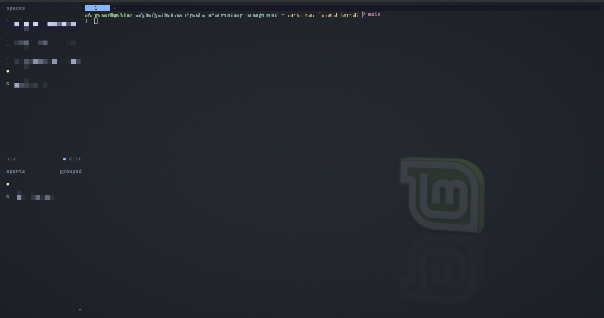
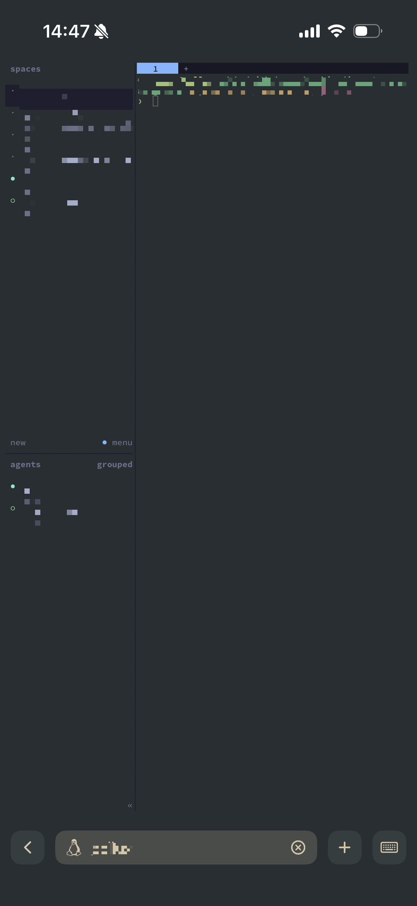
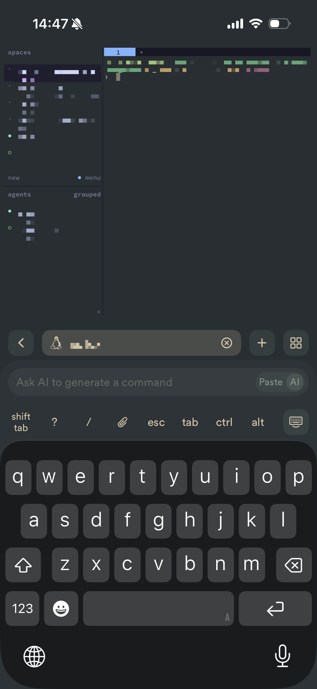
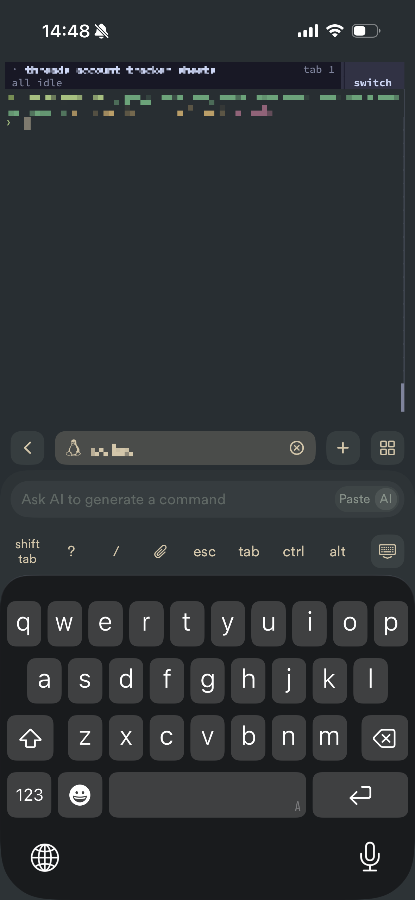

## はじめに

私は普段Claude Codeを使って開発をしています。  
最近は[クラウド環境でClaude Code](https://code.claude.com/docs/ja/claude-code-on-the-web)を実行できるようになり、これはとても便利なのですが、権限周りに少しクセがあったり、自前の環境を使いたくなったりすることもあって、まだまだ自宅PC上でClaude Codeを利用する機会が多いです。  
また、[Claude Code Remote Control](https://code.claude.com/docs/ja/remote-control)の機能を使うと、実行中のセッションをスマホアプリから簡単に確認・操作できます。これによりスマホからでも手軽に開発を進められますが、そもそものセッションの起動・管理や、自宅PCでの細かい作業は結局PCの前で行う必要がありました。  
そこで今回、スマホから自宅PCにSSH接続できる環境を整備してみました。

今回のポイントは以下です。
- 外出先からも安全にSSHできる：セキュリティ上、自宅ルーターのポート開放はしたくないのでVPNを活用します。
  - Tailscale、Termiusで実現
- PCの直接操作とスマホからの操作で、相互に作業を引き継げる：自宅にいるときはPCを直接操作するので、どこからアクセスしても作業をシームレスに引き継げるのが理想です。
  - herdr（ターミナルマルチプレクサ）で実現

## 構成情報

### 完成図


### 利用ツール

| ツール名 | 概要 | 料金 |
| --- | --- | --- |
| [Tailscale](https://tailscale.com/) | WireGuardベースのメッシュVPN。端末同士をP2Pでつなぐので、ルーターのポート開放なしで外から自宅PCにアクセスできる | 無料（Personalプラン：非商用・6ユーザーまで） |
| [Termius](https://termius.com/) | iOS / Androidで使えるSSHクライアント。スマホからのSSH接続に利用 | 無料（Starterプラン）<br>有料のProは $10/月（年払い） |
| [herdr](https://github.com/herdrdev/herdr) | コーディングエージェント向けのターミナルマルチプレクサ。セッションをバックグラウンドで維持し、どの端末からでもdetach / attachできる | 無料（OSS） |
| [Claude Code](https://code.claude.com/) | コーディングエージェント。Remote Control機能でスマホのClaudeアプリからセッションを操作できる | Pro以上のプランが必要<br>Pro：$20/月（年払いなら $17/月）、Max：$100/月〜 |

※ 料金は2026年11月時点のものです。

### herdrについて補足

herdrはコーディングエージェント向けのターミナルマルチプレクサです。そもそもターミナルマルチプレクサとは、1つのターミナル画面の中で複数の仮想的な端末セッションやウィンドウ、画面分割（ペイン）を同時に管理・操作できるソフトのことです。セッションの永続化と共有が可能なので、SSH接続が途中で切れてもセッションは残り続けて作業が止まることはなく、既存のセッションにアタッチすれば作業を継続できます。  
ターミナルマルチプレクサとしてはtmuxが有名で、私も以前は利用していたのですが、herdrを試してみたところ使い勝手が良かったので、今はこちらに移行しています。

herdrについてはこちらの記事が詳しいです。  
https://zenn.dev/dragon1208/articles/45708cc45a7a7c

個人的には、GUI操作がしやすい点と、herdr自体をCLIから操作でき、[公式スキル](https://github.com/herdrdev/herdr/tree/master/skills/herdr)を入れておくとコーディングエージェントがペインを分けるなどの操作をしながら作業してくれる点が気に入っています。

## 構築手順

### スマホから自宅PCへのSSH接続

SSH接続の部分については、以下の記事に今回と同様の構成がまとめられていたので、そちらを紹介して本記事では割愛します。

https://zenn.dev/fuku_tech/articles/bba079706955fd

### herdrのインストールと接続

#### 自宅PCにインストール

Linuxの場合、インストールは以下のコマンドで行います。
```bash
curl -fsSL https://releases.herdr.dev/app/install.sh | sh
```

以下のコマンドで起動できます。
```bash
herdr
```

herdrを起動すると、ターミナルは以下のようになります。左側に、開いているスペースの一覧とエージェントの状態が表示されます。



#### スマホ上でherdrにアタッチする

スマホからherdrにアタッチするには、TermiusでSSH接続した状態で、同じく`herdr`コマンドを実行するだけです。

スマホ上では以下のように表示されます。縦長ですが、PCで見たレイアウトがそのまま表示されています。小さいので少し操作しづらいですが、タップでスペースの切り替えやタブの追加なども可能です。



キーボードを出すとこんな感じです。



画面は拡大・縮小でき、拡大すると以下のような表示に変わります。先ほど左側にあったスペース一覧などが消え、上部に移動しています。この「switch」をタップするとスペースを切り替えられます。



## まとめ

Tailscale、Termius、herdrを使って、スマホから自宅PCにSSHして作業する環境を整備してみました。  
herdrのおかげで、どの端末から操作しているかを気にすることなく作業を継続できるのでとても便利です。  
ただ、やはりスマホの小さい画面と打ちにくいキーボードだけで複雑なコマンド操作をするのは厳しいと感じました。Claude CodeをTermius上で操作するのも少し使いづらいので、今のところTermiusでの作業はClaude Codeのセッション管理など必要最小限にとどめ、それ以外はClaudeアプリからRemote ControlでClaude Codeを操作する形にしています。
